# **GNSS Global Repository (GREP) Software**

> **Issued by**: University of Tartu / Kalev
> Rannat
>
> **Date:** 11/11/2026
>
> **Ref:**
> D311_bis_2.8.2_GREP_DL_2026_GNSS_Global_Repository\_(GREP)\_Software_with_Documentation
> \_(SD)
>
> **Official reference number service contract:**
> ECMWF/COPERNICUS/2025/C3S2_311_bis_MU

This document has been produced in the context of the Copernicus Climate
Change Service (C3S).\
The activities leading to these results have been contracted by the
European Centre for Medium-Range Weather Forecasts, operator of C3S on
behalf on the European Union (Contribution Agreement signed on
22/07/2021). All information in this document is provided “as is” and no
guarantee of warranty is given that the information is fit for any
particular purpose.

The users thereof use the information at their sole risk and liability.
For the avoidance of all doubt, the European Commission and the European
Centre for Medium-Range Weather Forecasts have no liability in respect
of this document, which is merely representing the author’s view.

# 

**Acronyms**

|  |  |
|----|----|
| ANUBIS | G-Nut/Anubis, A tool for checking the quality of multi-GNSS observations and content of data files/streams |
| CACS | Canadian Active Control System |
| C3S | The Copernicus Climate Change Service |
| CDDIS | The Crustal Dynamics Data Information System |
| CORS | Continuously Operating Reference Station |
| CSV | Comma Separated Values |
| ECMWF | The European Centre for Medium-Range Weather Forecasts |
| EPN | EUREF Permanent GNSS Network |
| EUREF | European Reference Frame |
| GNSS | Global Navigation Satellite System |
| GREP | Global RINEX Data Repository |
| IGS | International GNSS Service |
| NCN | (NOAA) Continuously Operating Reference Station (CORS) Network |
| NOAA | National Oceanic and Atmospheric Administration |
| RINEX | Receiver INdependent EXchange (RINEX) files are the industry standard for GNSS data |
| SIRGAS | Geodetic Reference System for the Americas |
| URL | Uniform Resource Locator, a unique identifier used to locate a resource on the Internet |
| UTARTU | University of Tartu |

# Introduction 

This document includes workflow explanations, expanded scientific
background, and technical commentary on each component of the Python
scripts used to retrieve and process the GNSS observational data and
metadata for the Global RINEX Data Repository (GREP). GREP is a repository of RINEX observations merging global, regional and national data repositories, (most of them are open-access repositories). 

The processing workflow performs:

- Data and metadata download and extraction

- Generating standard long RINEX filenames

- Removing/out-filtering duplicated sites from the processing queue
  (redundant sites)

- Quality check of the data (site coordinates, comparing RINEX headers
  with site logfiles)

- Storing the data not passed QC into dedicated folders (without
  changes/corrections made)

- Compiling the tables of QC-results and processing history

- Writing the results to GREP by YYYY/DOY, updating the metadata (and
  processing history?) tables

Initial data for GREP (GNSS observational data and metadata) is
downloaded from remote repositories, each having its own data access
rules and technical requirements. The process is fully automated but
needs supervision and maintenance in case of long internet connection
time-outs or any unexpected processing errors detected.

# Software archival location

The GREP repository can be found at URL:
<https://github.com/krannat/C3S2_311_bis_GREP> .

<u>GREP (modular) Structure:</u>
 
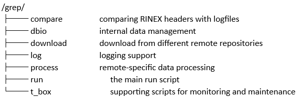

Data and processing outputs:

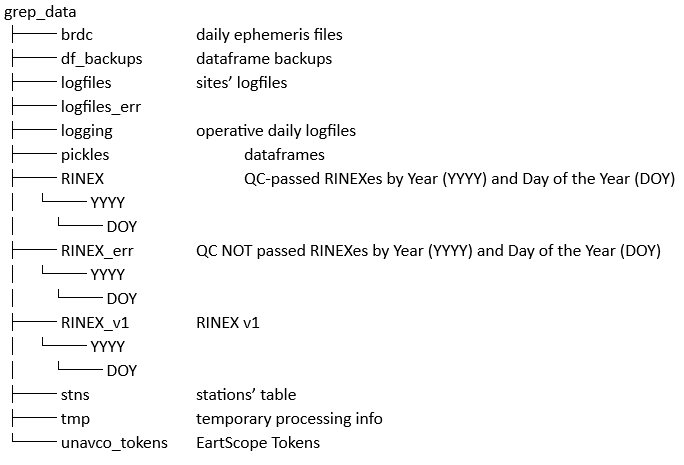

3rd parties’ software (licences described in DL-deliverable):

Installed under ~/Tools:

Anubis-3.9, gfzrnx_2.2.0_lx64, interp_1min (together with the EGM2008
grid-file).

License: CC-BY-4.0

## 2.1 Technical specifications

Programming Language:

- Python 3.x

Package Management / Environment:

The following pre-installed packages (as given in requirements.txt) must
be installed into the virtual environment of GREP.

Supported Operating Systems:

- Linux (tested on Debian, Fedora 35, Rocky 9.3)

System Requirements:

- CPU: Multi-core processor for parallel processing

- RAM: 32 GB recommended

- Storage: Tens of TBytes (and growing)

- Network: High-speed Internet connection for parallel data download

Notes:

- All processing is done at ECMWF Virtual Machine

- Some remote repositories (data providers) require FTP

# Installation instructions

Provide step-by-step installation instructions
including screencaps of all steps.

Document clearly any system dependencies and installs
of third party software / application packages required.

Note: Installation should not require
sysadmin privileges

In general, the installation process consists of 5 steps and
user-specific configuration described below.

1st step – clone GREP scripts from git into your working
directory.

2nd step – create the required directory tree into your local
file system

3rd step – modify config.py according to your local file
system

4th step – install all required Python packages (based on
requirements.txt) and stn_table (under grep_data/stns/)

5th step – ask/get personal access (ssh-keys, access tokens)
to all remote GNSS data repositories

<u>Configuration of GREP in any local file system starts with
configuring the paths</u>:

BASE_PATH = directory to where_to_install_grep'

'/home/grep_user/’ -- directory for installing 3rd parties’
software

and,

getting personal credentials for accessing EarthData and EarthScope and
Greenland remote servers.

<u>These missing parameters must be written into the GREP configuration
file config.py:</u>

BASE_PATH = 'where_to_install_grep'

anubis_executable = '/home/grep_user/Tools/anubis-3.9-lin-static-64b'

rx3name_executable = '/home/grep_user/Tools/RX3name'

rin1to2_executable = '/home/grep_user/Tools/gfzrnx_2.2.0_lx64'

greenland_username = 'grep_user'

greenland_password = 'grep_user_pwd'

chile_rinex_temp_down_path = 'free choice' \# tests and bulk download
from CSN (Chile)

<u>Installing stations’ table</u>:

It is highly recommended to pre-install the rather long stn_table into
/grep/stns/ before starting to run the script on any network/repository.
Starting from an empty stations list may trigger massive 429 Errors from
Nominatim (too many requests in a short period of time), which can
ultimately result in sites being excluded from routine data processing.
When adding a new network, it is advisable to carefully check for
Nominatim-related errors during the processing of the first day. If
necessary, rerun the first day several times until all stations have
been successfully resolved and added. This procedure is safe, as
duplicate entries are not created since no data is processed twice.

<u>Installing 3rd party software</u> <u>(in /Tools)</u>:

Anubis: download the free version of executable from
<https://gnutsoftware.com/software/anubis/download>

gfzrnx_2.2.0_lx64: download the executable from
<https://gnss.gfz.de/products/gfzrnx/downloads>

Nominatim: must have GeoPy installed (pip install geopy). geopy is a
Python client for geocoding web service Nominatim. The use policy:
<https://operations.osmfoundation.org/policies/nominatim/>

The interp_1min for EGM2008: executable must be compiled from source
interp_1min.f into /EGM2008_WGS84 (the grid-file https://drive.google.com/file/d/1DbOlgpLgq1YRs8iJ9e3wnmH_Yd4BKHIZ/view?usp=drive_link must be installed to
the same directory). Just copying executable from one file system to the
next may not work. After compilation run a test by comparing the sample
file INPUT.DAT and OUTPUT.DAT (given in GitHub).

Staying in /EGM2008_WGS84 run a test in command line:

./interp1_min INPUT.DAT

The output is a csv-file (OUTPUT.DAT), each line containing the same
coordinates, but the 3rd item is the interpolated
amsl-height. The line numbers must conform with the line numbers in
INPUT.DAT.

<u>EarthScope access</u>:

EarthScope uses Bearer access tokens for authentication to access GNSS
data and NSF National Geophysical Facility (NGF) services. The
instructions can be found at
<https://www.earthscope.org/data/authentication/> and for the
programmatic access the user must install the EarthScope SDK
<https://gitlab.com/earthscope/public/earthscope-sdk/> .

<u>EarthData access</u>:

As a 1st step, create a personal EarthData login account:

<https://urs.earthdata.nasa.gov/oauth/authorize?client_id=gDQnv1IO0j9O2xXdwS8KMQ&response_type=code&redirect_uri=https%3A%2F%2Fcddis.nasa.gov%2Fproxyauth&state=aHR0cDovL2NkZGlzLm5hc2EuZ292L2FyY2hpdmU>

The 2nd step – create the .netrc file into your /home
directory

<https://www.earthdata.nasa.gov/centers/cddis-daac/archive-access> with
brief instructions under Python3 examples for a .netrc file set up:

- To create a .netrc file, you will need to create a text file with the
  name .netrc; this file needs to have read permissions set to only
  yourself, so that no one can read your file and get your username and
  password. The format of the file is:

- machine urs.earthdata.nasa.gov login \<username\> password
  \<password\>

- where \<username\> and \<password\> are the values you set when you
  created your Earthdata login account.

<u>Greenland</u>:

For getting access to the data (registering user and password), contact
GNET PI at <https://go-gnet.org/contact>

Settings in local file system (for accessing remote servers):

.ssh, .netrc (for EarthData/CDDIS)

The *known_hosts* file must include IP address for Geoscience Australia
and .ssh the keys for any other service providers that require
identification for resource access. We cannot guarantee that
intervention by the local sysadmin can be avoided.

# Usage instructions

Clearly describe how to use the software in a
step-by-step manner including at least one sample processing with
relevant screencaps

GREP can be run in different modes (for different use cases):

1)  Processing yearly data from all sources/networks simultaneously (max
    1 year per session)

2)  Processing data on a network basis (must edit the site list in
    config.py). The list of networks consists of the network names and
    is expandable. The list can contain also just one item, if trying to
    process data from one network only (for example, ‘epn’).

3)  Adding data missing from earlier processing (filling the data
    processing gaps)

The internal data tables and stations’ list will be updated
automatically. However, adding completely a new data source requires
writing additional source-specific functions/modules according to the
technical requirements of the new network, and integration to the GREP
package.

<u>Preparing to run grep-script</u>:

Create Python virtual environment (ref.
<https://docs.python.org/3/library/venv.html>) into path_to_grep.

python3 -m venv /path_to_grep/

Copy run_grep.sh into your working directory, and make changes to the
lines:

cd /path_to_grep/grep/

source /path_to_grep/grep_venv/bin/activate

logfile="/my_path_to_nohup_output/nohup_out\_\${datestr}.log",

where the “my_path_to_nohup_output” according to user’s own preferences.
After making the changes, the script must be made executable.

It is suggested to run the long-lasting processes with nohup. The nohup
command allows processes in local Linux system to keep running after the
terminal closes. Additional benefit can be seen in a possibility to
inspect the process running and to analyse the last tasks performed in
case in script malfunction or unexpected termination.

A shell-script run_grep.sh takes care about activation of the Python
virtual environment and using Nohup.

<u>Starting the data processing</u>:

Copy run_grep.sh into your working directory and run it in command line:

grep.sh year from_doy to_doy

where the 4-digit year denotes the year, and from_doy and to_doy denote
the starting day of the year and the ending day of the year chosen for
data processing.

Ideally, once the script is initiated, the GREP repository should
autonomously expand without requiring external intervention. However,
the application's functionality relies on an external online service
(Nominatim) and the accessibility of various data provider servers. If
any of these services experience prolonged downtime, the script cannot
proceed, and the issues must be resolved.

The first step in verifying that the processing is running successfully
is to inspect the daily.log and daily_errors.log files in the logging/
directory (see also a section for testing below). These files provide
detailed information about the processing workflow and any errors
encountered. A log-rotation function is available that renames these
files to .1, .2, etc., while retaining up to 40 backup copies. The
rotated log files are also stored in the corresponding daily RINEX
directory (RINEX/YYYY/DOY).

In practice, data providers' repositories showed great heterogeneity
(different data formats, compression rules, file naming conventions,
data transfer protocols, security rules, etc.). Every new network may
require the system administrator to implement some changes. For any
changes like this, the GREP processing must be stopped. This also
implies that the GREP will be regularly monitored and maintained over
the long term. Operators of the GREP shall be aware of changes planned
and made by data providers, for implementing changes to the code, if
necessary.

**Known limitations**:

- Technical restrictions for Nominatim (max number of requests per day
  and per time unit
  <https://operations.osmfoundation.org/policies/nominatim/> ).

- Internet connection time-out – the script will not stay waiting, it
  will stop after a limited number of trials to reconnect.

- The workflow gets broken by unknown exception. This is option is
  intentionally left for safety – the situation must be handled by a
  skilled person. The working scripts may need some updates and the GREP
  data repository may need maintenance before restart. These issues may
  arise due to changes (modified structure of the remote repository or
  changes in data transmission protocols) made in any of the remote
  servers.

- In one session the GREP can process maximum one year of data. It is left so for practical reasons. The processing may last long – days, weeks, months, depending on a number of networks and the interval of days chosen. It does not make sense to process long time intervals without checking the logfiles, for being sure that everything was processed correctly.

- Data download from NCN and Geoscience Australia relies on Amazon AWS. It is a critical dependency. GREP can use alternative solutions, but without AWS service the data download speed drops down radically and the connections to the remotes may get unstable.   

# Testing

Describe how to run against any test packages. If
formal test packages do not exist describe how to verify successful
installation and performance e.g. by recreating a sample output from
sample input provided in the software archive package.

The following commands can be used to process a single day of data from
the CACS network. This provides a compact example of how the stn_table,
pickle files, as well as RINEX and logfile directories evolve during
processing, how to check comparing.txt contents, and how to verify GREP
processing logfiles for potential ERROR messages.

<u>1. Set two shortcuts (B = data folder, T = folder for the test
notes):</u>

B=/path/to/data/folder; T/path/to/test/notes; mkdir -p \$T; cd
/path/to/grep/scripts

<u>2. To show the test configuration:</u>

grep -n "^network_list\\\|^BASE_PATH\\\|^pkl_path" config.py

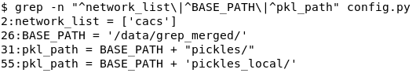

<u>3. Save a timestamp and a copy of the station table:</u>

touch \$T/start_marker; cp \$B/stns/stn_table.csv
\$T/stn_table_before.csv

<u>4. Count what exists now and save it to before.txt</u>

{ echo "stn_table rows: \$((\$(wc -l \< \$B/stns/stn_table.csv)-1))";
echo "logfiles: \$(ls \$B/logfiles \| wc -l)"; echo "RINEX/2025/001:
\$(ls \$B/RINEX/2025/001/\* 2\>/dev/null \| wc -l)"; } \| tee
\$T/before.txt

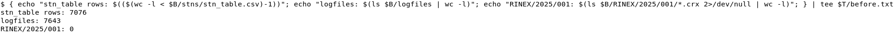

<u>5. Run the test for 2025, doy of year 001:</u>

grep.sh 2025 1 1

6\. After the run use the same count command as Step 4, but it saves to
after.txt:

{ echo "stn_table rows: \$((\$(wc -l \< \$B/stns/stn_table.csv)-1))";
echo "logfiles: \$(ls \$B/logfiles \| wc -l)"; echo "RINEX/2025/001:
\$(ls \$B/RINEX/2025/001/\* 2\>/dev/null \| wc -l)"; } \| tee
\$T/after.txt

<u>7. Show before and after side by side</u>

diff -y \$T/before.txt \$T/after.txt

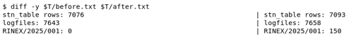

<u>8. Rows added or changed in stn_table.csv:</u>

diff \$T/stn_table_before.csv \$B/stns/stn_table.csv \| grep '^\[\<\>\]'

<u>9. Stations that needed a Nominatim query:</u>

grep -h "Making a Nominatim query" \$B/RINEX/2025/001/daily.log

<u>10. Number of new logfiles:</u>

find \$B/logfiles -type f -newer \$T/start_marker \| wc -l

<u>11. The first 5 of new logfiles:</u>

find \$B/logfiles -type f -newer \$T/start_marker \| head -5

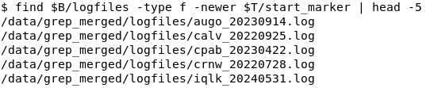

<u>12. Check if some RINEX files were rejected (if yes then inspect
daily_errors.log):</u>

ls \$B/RINEX_err/2025/001 2\>/dev/null \|\| echo "No RINEX_err/2025/001
folder -\> no RINEX files rejected"

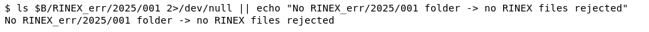

<u>13. Check the content of the dataframe (output table), rows per day
(YYYYDOY):</u>

cut -d, -f2 \$B/df_backups/2025/2025_01.csv \| tail -n +2 \| cut -c13-19
\| sort \| uniq -c

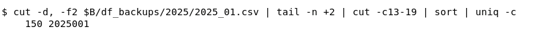

<u>14. A sample of the content (site, RINEX file, matched logfile):</u>

grep 2025001 \$B/df_backups/2025/2025_01.csv \| head -10 \| cut -d,
-f1,2,6

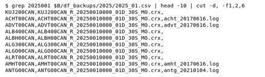

<u>15. Number of sites per error code (0 = consistent):</u>

grep -E '\\.(crx\|rnx)'
\$B/RINEX/2025/001/comparing_log_rinex_2025_001.txt \| awk -F'\|'
'{print (\$4==""?"no logfile":\$4)}' \| sort \| uniq -c \| sort -rn

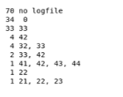

<u>16. Check the processing logs for error messages. Number of messages
per type for DOY 001:</u>

awk '{print \$3}' \$B/RINEX/2025/001/daily_errors.log \| sort \| uniq -c

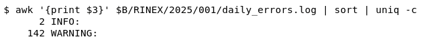

# Verification

Provide a snapshot of successful installation of the
software on a third-party machine including verification against the
tests described in Section 5. If exceptionally this is not possible
(e.g. requires install on a second supercomputing facility and no access
rights to do so) then state clearly as an exception.

To ensure, that everything is installed and works appropriately, it is
suggested to contact the developers for running a test-set of networks
and a fixed number of consecutive days on a platform independent of a
new user. The results and logfiles can be compared after the test-run.
